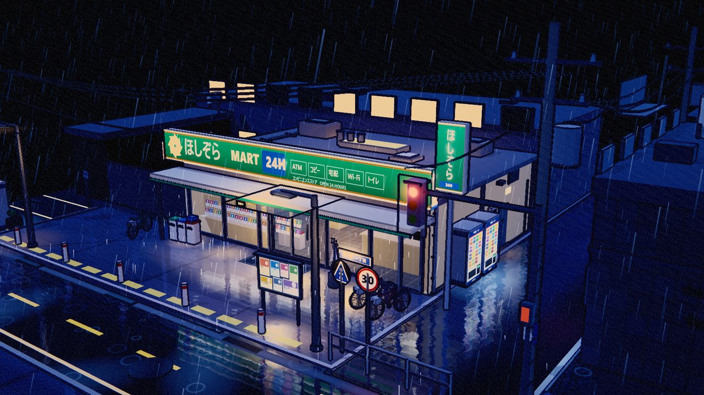
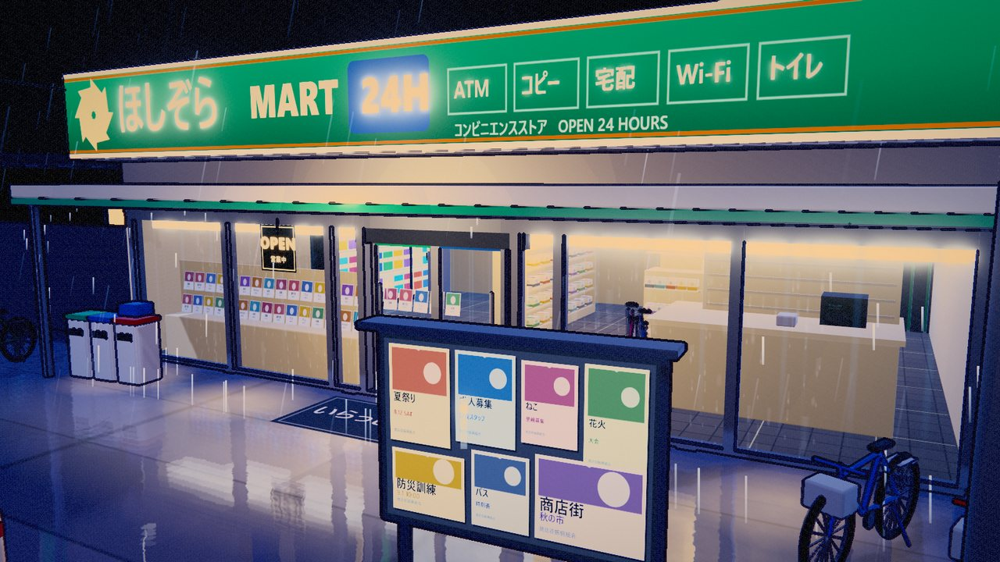
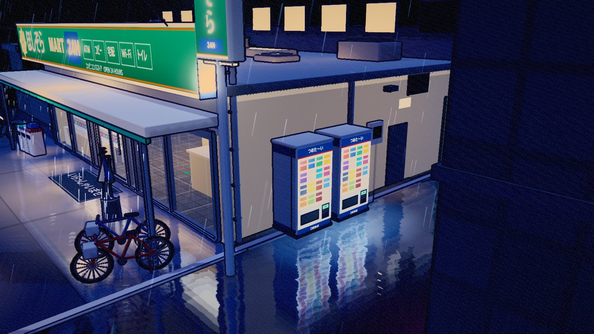
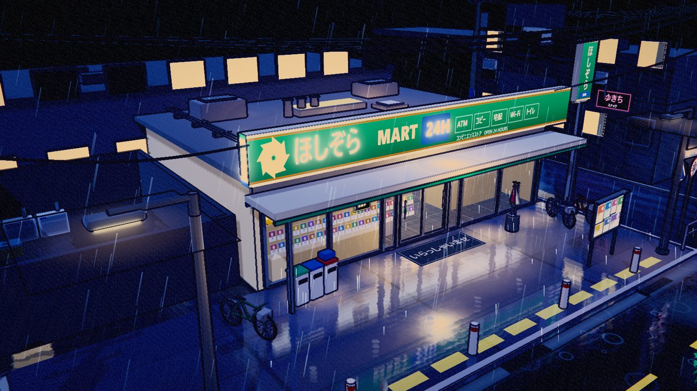
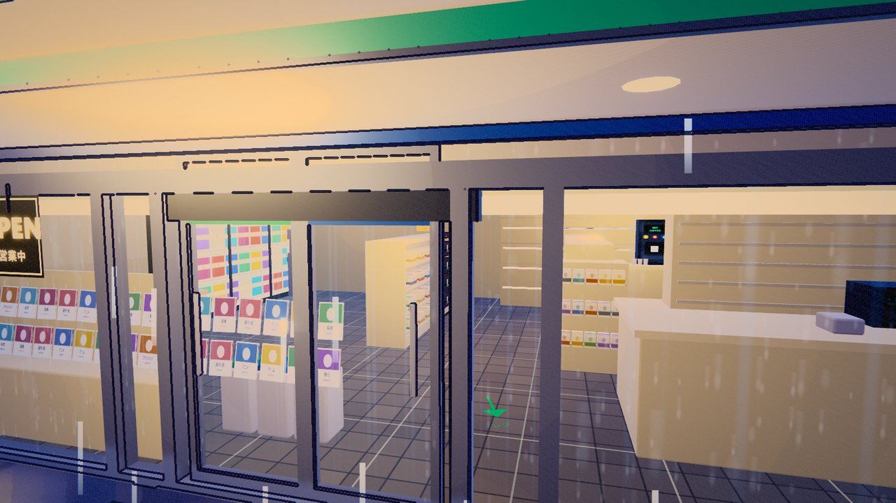
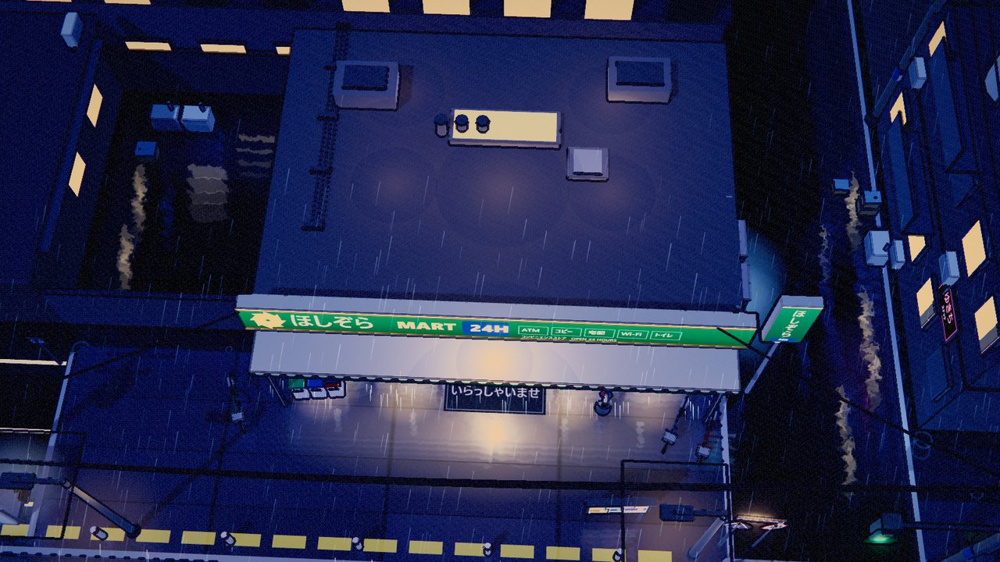

# 雨夜のコンビニ · Rainy Night Konbini

A cel-shaded, fully procedural **rainy-night Japanese convenience-store corner** — built as a collectible miniature diorama you can orbit, zoom and inspect from any angle.

**No Blender. No model files. No image assets.** Every mesh, every texture (painted on a `<canvas>` at boot), every material, every post-processing pass and every animation is generated by code.

<p align="center">
  
</p>

---

## Quick start

```bash
git clone https://github.com/SingBoJia/rainy-night-konbini.git
cd rainy-night-konbini
npm install
npm run dev          # → http://127.0.0.1:5178/
```

Static build:

```bash
npm run build
npm run preview      # → http://127.0.0.1:5179/
```

Requires a **WebGL2** browser (Chrome / Edge / Firefox). The scene opens immediately — **there is no UI whatsoever**. Drag with the left mouse button to orbit, right-drag to pan, scroll to zoom.

---

## What makes it look like an anime still

| Technique | Where |
|---|---|
| **Cel shading** | `src/core/toon.js` — a hand-tuned 5-band gradient ramp (`DataTexture`, nearest-neighbour sampling) shared by every `MeshToonMaterial` |
| **Anime rim light** | Injected via `onBeforeCompile`; a fresnel term is added to the final colour so silhouettes glow against the dark |
| **Ink outlines** | `src/core/pipeline.js` → `InkOutlinePass` — depth + normal buffer, 8-direction screen-space sampling, tuned to stay readable at distance |
| **Bloom** | `UnrealBloomPass`, threshold-gated so only lightboxes, neon and wet highlights blow out |
| **Colour grade** | Custom shader: ACES approximation, split-tone (cool shadows / warm highlights), vignette, film grain, subtle chromatic aberration |
| **Wet ground reflection** | `src/world/wet.js` — planar mirror pass at half resolution, updated every other frame, clipped at the mirror plane; injected into road/sidewalk materials with noise-driven ripple distortion and a fresnel term |
| **Shop glass** | `glassShader` — fresnel-only sheen plus condensation streaks. No specular highlights, so the interior stays readable from *any* angle |

The whole frame is one composer chain:

```
scene ──► [depth/normal RT] ─┐
      └─► render ──► bloom ──► ink outline ──► grade ──► screen
```

---

## Project layout

```
src/
  main.js                  assembly, lights, main loop, OrbitControls
  core/
    toon.js                gradient ramp / toon material / glow / glass shader
    pipeline.js            post-processing chain (outline / bloom / grade)
    textures.js            every Canvas-procedural texture
    utils.js               geometry + placement helpers
  world/
    layout.js              single source of truth for all dimensions
    materials.js           material library (wet + dry twins)
    wet.js                 planar reflection + wet-material injection
    street.js              square plinth, road, crosswalk, gutters, puddles
    konbini.js             store shell, glazing, interior, auto door
    neighbourhood.js       surrounding blocks, alley, poles, wires, signal
    props.js               vending machines, bicycles, umbrella stand, lamps…
    effects.js             GPU particles: rain, drips, ripples, glass rain
tools/                     headless screenshot harness (puppeteer-core)
prompts/                   the prompt library that spawned this project
docs/                      README imagery
```

~4,600 lines of JavaScript. 1,062 meshes. 15 lights.

---

## Animation

- **Rain** — 2,600 GPU particles in a single draw call; wind offset, distance fade
- **Canopy drips** — intermittent droplets off the awning edge
- **Puddle ripples** — 520 expanding rings on randomised phases
- **Sign flicker** — slow breathing plus rare brown-out stutter (fascia / pole sign / OPEN / ceiling panels / alley neon)
- **Auto door** — 19 s loop: closed → slide open → hold → slide shut
- **Rain on glass** — three parallax layers of droplets crawling down with trails
- **Ground reflection** — live planar mirror, reacts to camera and lights
- **Traffic signal** — 24 s cycle (green 10 s / amber 3 s / red 11 s), driving both the lamp and the wet-road light pool

---

## What's in the box

**Outside** — fascia sign, glass frontage, automatic doors, awning, doormat, vending machines ×3, bicycles ×3, umbrella stand, sorted bins, street lamps ×4, utility poles ×3 (transformer, insulators, cross-arms), catenary wires, road signs (crossing / speed limit / street name / bicycle parking), corner guard rails, parking bays with wheel stops, gutters and grates, manholes, puddles, reflective crosswalk, alley mouth (neon sign + AC unit + crates), notice board, planters, rooftop plant, fire escape, water tank.

**Inside** — two gondola shelf runs (four tiers, double-sided stock), endcap, backlit drink coolers, bento / onigiri wall, magazine rack (42 covers), counter with register and card terminal, cigarette display, coffee machine, oden counter with sneeze guards, ATM corner, lockers, back-room door, in-store posters, ceiling light panels, floor guidance arrow, tiled floor, door-side bins.

---

## Screenshots

| Front | Alley |
|---|---|
|  |  |

| From the left | Through the glass |
|---|---|
|  |  |

<p align="center">
  
</p>

---

## Prompt library

The `prompts/` folder holds the prompt that produced this scene plus **six sibling scenes** (late-night ramen yokocho, snowbound onsen inn, Showa-era shopping street, coin laundry, seaside station platform, cherry-blossom riverbank) and a reusable template + module library. All share the same technical constraints, so they can be built on top of this renderer directly.

---

## License

MIT — see [LICENSE](LICENSE). Everything is procedurally generated; modify freely.
